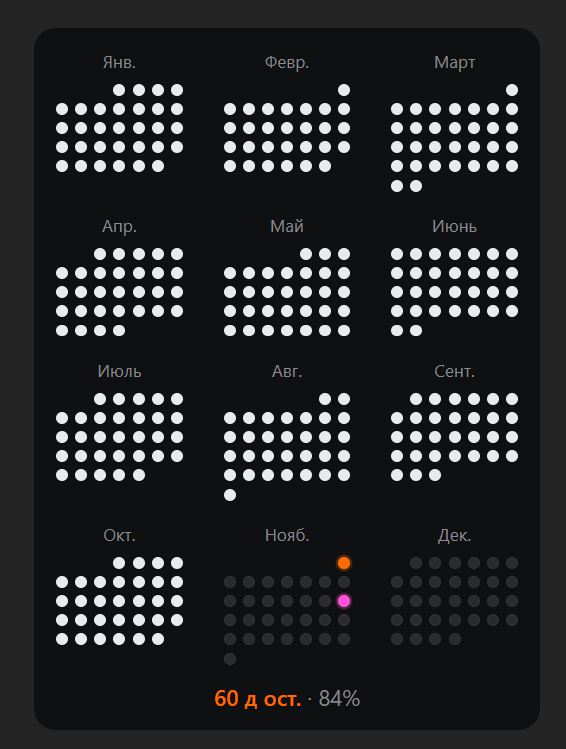

# Dot Calendar

Годовой календарь, в котором каждый день — отдельная точка. Он помогает увидеть, какая часть года уже прошла и сколько времени осталось.



## Что уже работает

- Все 12 месяцев на одном экране.
- Прошедшие дни отмечены светлым цветом, будущие — тёмным, текущий день — оранжевым.
- Внизу показаны оставшиеся до конца года дни и процент прошедшего года.
- Отдельным датам можно задавать цвет через настройки в коде.
- В текущем примере 15 ноября выделено розовым как день рождения.
- Названия месяцев учитывают язык браузера; по умолчанию неделя начинается с понедельника.

## Потенциал развития

Календарь можно развить в наглядный инструмент планирования важных дат и сроков:

- Добавлять события: день рождения, отпуск, экзамен или завершение проекта.
- Устанавливать сроки для целей и задач.
- Показывать обратный отсчёт до выбранной даты: например, «До отпуска осталось 24 дня».
- Выделять период подготовки и отображать, какая его часть уже прошла.
- Сохранять события и настройки между посещениями.

Это направления развития: сейчас приложение показывает отсчёт до конца года; создание событий и обратный отсчёт до произвольной даты ещё не реализованы.

## Запуск

Нужны Node.js и npm, совместимые с Vite 7.

```sh
npm install
npm run dev
```

Сборка и просмотр собранного приложения:

```sh
npm run build
npm run preview
```

## Настройка

Год и цветовые отметки задаются в `src/App.vue`. Сейчас в примере выбран 2026 год. Ключ отметки — дата в формате `YYYY-MM-DD`; доступные значения: `muted`, `white`, `accent`, `bday`.

Особая отметка дня рождения задана в `src/utils/getDotClass.ts` и имеет приоритет над остальными цветами.

## Технологии

Vue 3, Vite, TypeScript и date-fns.

[Путеводитель по проекту](PROJECT_GUIDE.md) · [Восстановление проекта](RECOVERY.md)
